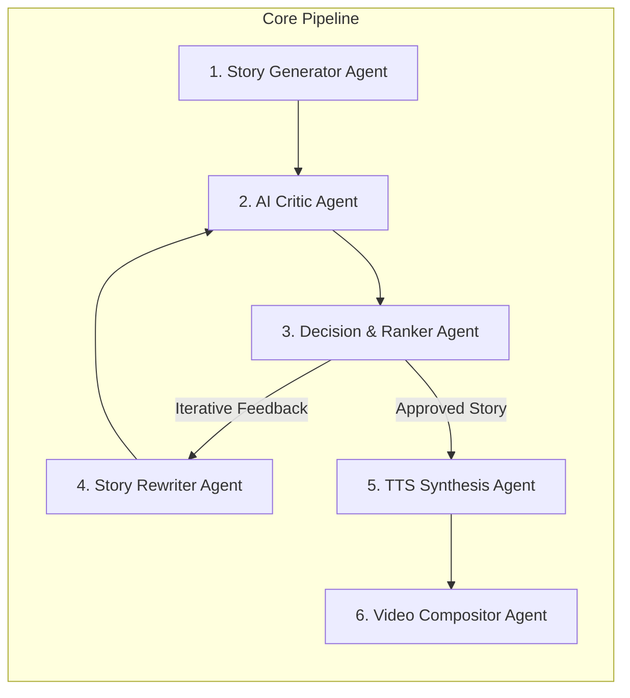

# Multi-Agent Specification & Orchestration
## Project: AI-Story-Engine
**An Agentic AI Pipeline for Automated Story Generation, Evaluation, and Short-Form Video Creation**

---

## 1. Agent Ecosystem Overview

The **AI-Story-Engine** utilizes a multi-agent cooperative architecture. Each agent encapsulates a specialized role, distinct behavioral prompts, deterministic input/output schemas, and failure recovery protocols.



---

## 2. Detailed Agent Specifications

### 2.1 Agent 1: Story Generator Agent
- **Role:** Award-winning viral storyteller and confession narrative specialist.
- **Model:** Ollama with Qwen LLM (`qwen3:8b` / `qwen2.5:7b`).
- **Core Directive:** Create 100% original, first-person confession stories (300–350 words) that feel genuine, emotionally resonant, and completely devoid of AI clichés.
- **Constraints:**
  - Strict first-person perspective ("I", "me", "my").
  - Irresistible hook within the first 15 words.
  - Conflict initiated within the first 2–3 sentences.
  - Ban on clichéd tropes ("Little did I know", "My blood ran cold", "I froze").
  - Generates 4 progression scene prompts for visual consistency.
- **Input:** System prompt template (`prompts/story_prompt.txt`) + optional user topic seeds.
- **Output:** Validated JSON matching `StoryPackage` schema (`title`, `hook`, `story`, `thumbnail_prompt`, `scene_prompts`).

---

### 2.2 Agent 2: AI Critic Agent (Quality Analyzer)
- **Role:** Senior YouTube Shorts & TikTok Retention Analyst.
- **Model:** Ollama with Qwen LLM.
- **Core Directive:** Deliver brutally honest, uninflated evaluations of audience retention, completion rate, and emotional engagement.
- **Evaluation Rubric (1–10 scale):**
  1. **Hook Strength:** Curiosity gap, scroll-stopping power.
  2. **Pacing:** Flow, velocity, elimination of narrative drag.
  3. **Emotional Impact:** Earned shock, empathy, suspense, or relief.
  4. **Believability:** Authentic narrator voice and plausible human reactions.
  5. **Twist Execution:** Logical inevitability in hindsight without unearned randomness.
  6. **Audience Retention:** Absence of swipe-away points.
  7. **Originality:** Uniqueness of premise and twist.
  8. **AI Naturalness:** Flagging generic transitions, overexplaining, or robotic cadence.
  9. **Comment Potential:** Controversy, debate, or relatable discussion prompts.
- **Invariants:**
  - **Logical Consistency Rule:** If plot contradictions or unearned twists exist, scores for Believability, Twist, and Overall must be $\le 6$, and verdict cannot be `ACCEPT`.
- **Input:** Story package JSON + `prompts/critic_prompt.txt`.
- **Output:** Validated JSON review with category scores, `overall` score, `confidence`, `weaknesses`, `improvements`, `ai_flags`, and `decision` (`ACCEPT`, `REWRITE`, `REJECT`).

---

### 2.3 Agent 3: Decision & Tournament Ranker Agent
- **Role:** Pipeline Controller and Candidate Selector.
- **Implementation:** Python Deterministic Agent (`app/ranker.py`).
- **Modes of Operation:**
  1. **Tournament Mode (Multi-Candidate Ranking):**
     - Generates $N$ independent candidate stories.
     - Runs each candidate through the AI Critic Agent.
     - Computes the composite viral ranking metric:
       $$\text{Rank Score} = (\text{overall} \times 0.4) + (\text{retention} \times 0.2) + (\text{hook} \times 0.2) + (\text{originality} \times 0.1) + (\text{believability} \times 0.1)$$
     - Executes tie-breaking rules if composite scores match.
  2. **Iterative Mode (Self-Improvement Loop):**
     - Checks if `overall >= ACCEPT_THRESHOLD` (default: 8.0).
     - Routes to Rewriter Agent if below threshold (up to `MAX_REWRITES` attempts).

---

### 2.4 Agent 4: Story Rewriter Agent (Editor)
- **Role:** Professional surgical story editor.
- **Model:** Ollama with Qwen LLM.
- **Core Directive:** Make the minimum necessary edits to address the Critic’s specific grievances while strictly preserving unflagged sections.
- **Preservation Rules:**
  - Maintain core plot, characters, setting, twist, and emotional core.
  - Do not rewrite paragraphs that scored well.
  - Only modify thumbnail or scene prompts if narrative edits visually alter them.
- **Input:** Story JSON + Critic Review JSON + `prompts/editor_prompt.txt`.
- **Output:** Revised Story JSON with identical schema.

---

### 2.5 Agent 5: Text-to-Speech (TTS) Agent
- **Role:** Neural voice artist and audio synthesizer.
- **Model:** Kokoro-82M Neural TTS (`lang_code="a"` or `"b"`).
- **Core Directive:** Synthesize natural, expressive human-like voiceovers at 24kHz.
- **Capabilities:**
  - Dynamic voice assignment (`af_heart`, `af_bella`, `am_adam`, `bm_fable`, etc.).
  - Sentence-level audio stream buffering.
  - Normalization and master export to `data/audio/story_{id:04d}.wav`.

---

### 2.6 Agent 6: Video Compositor Agent
- **Role:** Automated vertical video editor and post-production compositor.
- **Engine:** MoviePy / FFmpeg + PIL subtitle typography engine.
- **Core Directive:** Transform audio voiceover and story metadata into an engaging 9:16 vertical video.
- **Workflow:**
  1. Ingests master narration audio and extracts duration.
  2. Selects ambient looping background footage (`assets/backgrounds/`).
  3. Crops and scales footage to 1080x1920 (9:16) at 30 FPS.
  4. Generates kinetic, high-retention subtitle cards (3–4 words per line, bold font with contrasting outline).
  5. Mixes narration with ambient background music (`assets/music/`) with -18dB ducking.
  6. Exports production-ready MP4 to `data/videos/story_{id:04d}.mp4`.

---

## 3. Inter-Agent Communication Protocols

All inter-agent communication is governed by typed JSON envelopes:

```
[Story Generator] --- (StoryPackage JSON) ---> [AI Critic]
                                                   |
                                            (CriticReview JSON)
                                                   v
                                          [Decision / Ranker]
                                         /                   \
            (Rejected / Under 8.0)      /                     \ (Approved)
                                       v                       v
                              [Story Rewriter]          [TTS Voice Agent]
                                       |                       |
                               (Revised Story)            (24kHz WAV)
                                       |                       v
                                       +----> [Critic]  [Video Compositor]
                                                               |
                                                          (1080x1920 MP4)
```

---

## 4. Extension Study: RAG & Fine-Tuning Evaluator Agents
For the academic extension study, two additional evaluators operate in parallel:
- **RAG Agent:** Ingests high-performing viral story exemplars into a local vector store to retrieve structural context dynamically.
- **Evaluation Benchmark Agent:** Computes comparative statistical scores between Baseline Qwen, RAG-augmented Qwen, and LoRA Fine-Tuned Qwen across 100 generated stories.

