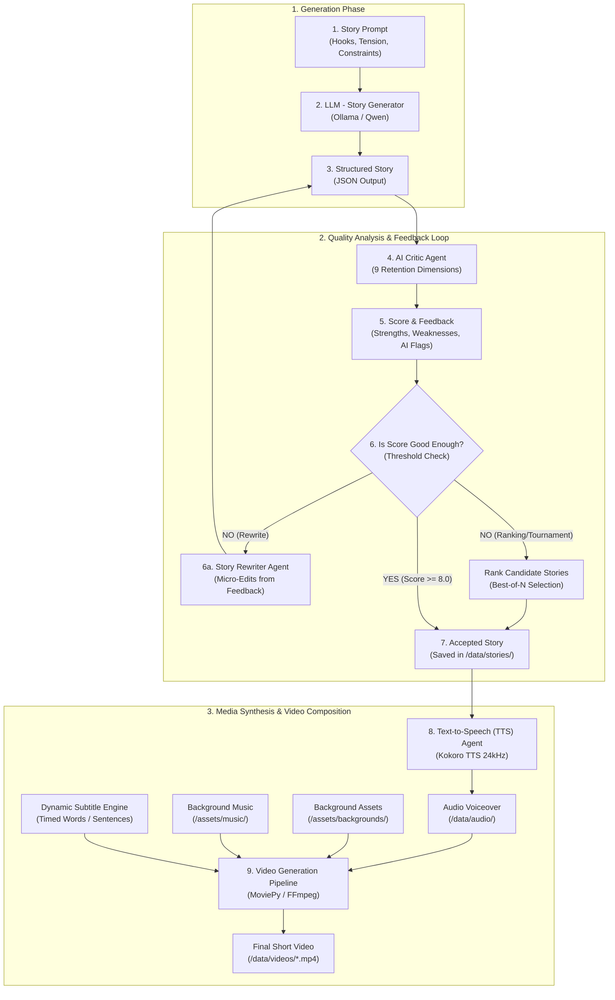
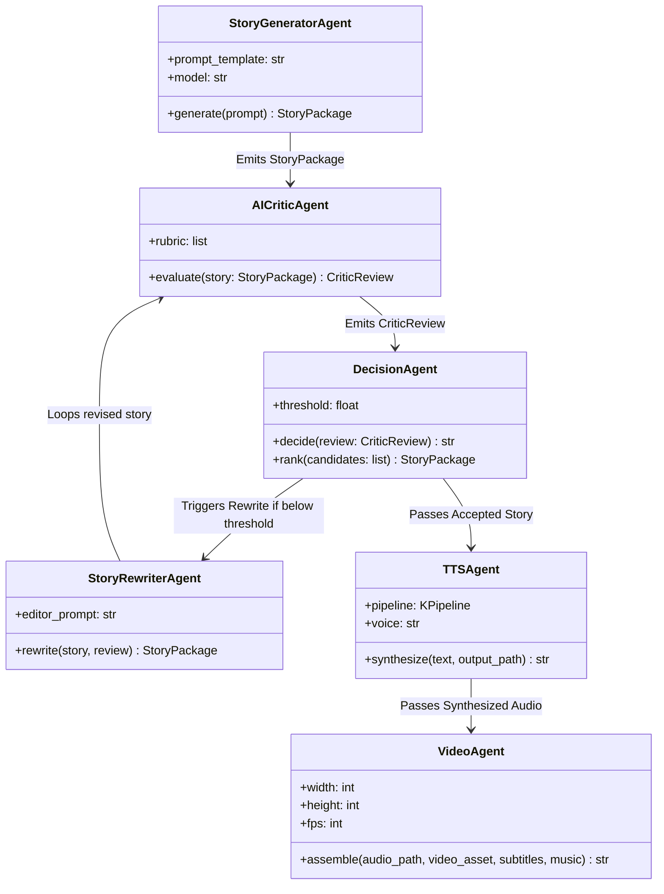
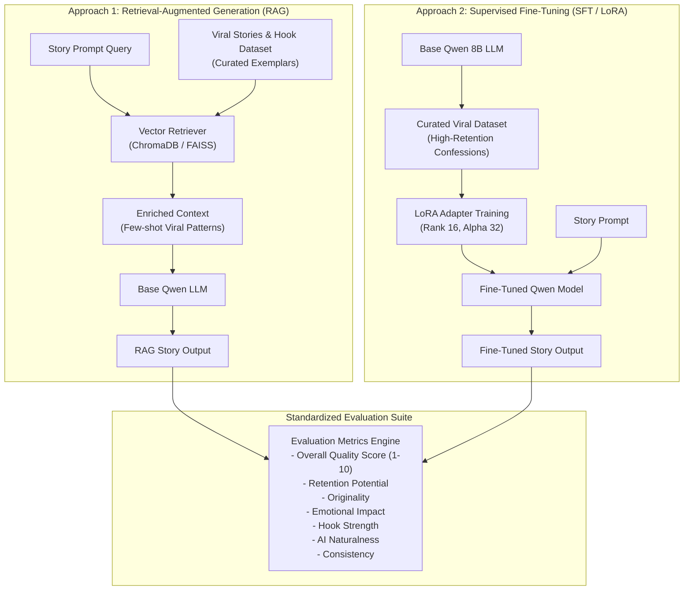

# System Architecture Document
## Project: AI-Story-Engine
**An Agentic AI Pipeline for Automated Story Generation, Evaluation, and Short-Form Video Creation**  
**Authors:** Siddhant Lawand (Roll No: 9), Madhoor Deo (Roll No: 13) | Panel C1  

---

## 1. High-Level System Architecture

The AI-Story-Engine is organized as a modular, agentic pipeline where independent autonomous agents collaborate sequentially and iteratively to produce polished viral short-form videos.



---

## 2. Agentic Workflow & Component Interactions

### 2.1 The Core Agents



---

## 3. Storage & Directory Architecture

The repository enforces a clean separation of code, prompts, media assets, generated outputs, and documentation:

```
AI-Story-Engine/
├── app/                      # Application Logic & Agent implementations
│   ├── __init__.py
│   ├── config.py             # System constants, models, voice & video specs
│   ├── llm.py                # Story Generator Agent (Ollama client)
│   ├── critic.py             # AI Critic Quality Analyzer
│   ├── editor.py             # Story Rewriter / Editor Agent
│   ├── ranker.py             # Best-of-N Candidate Tournament Selector
│   ├── tts.py                # Kokoro Neural Text-to-Speech synthesis
│   ├── subtitles.py          # Dynamic subtitle and timestamp generator
│   └── video.py              # FFmpeg / MoviePy Video Compositor
├── prompts/                  # Carefully tuned system & prompt templates
│   ├── story_prompt.txt      # Viral Reddit/Shorts story generation prompt
│   ├── critic_prompt.txt     # 9-dimension brutally honest critic prompt
│   └── editor_prompt.txt     # Micro-edit preservation prompt
├── data/                     # Output directory for pipeline artifacts
│   ├── stories/              # Saved JSON story packages (story_0001.json)
│   ├── audio/                # Master 24kHz voiceover WAV files
│   └── videos/               # Rendered 1080x1920 MP4 Shorts
├── assets/                   # Static media libraries
│   ├── backgrounds/          # Looping ambient video clips (nature, city, abstract)
│   ├── music/                # Royalty-free background music tracks
│   └── fonts/                # Bold typography fonts for short-form subtitles
├── docs/                     # System architecture, PRD, TRD, UI/UX, Design specs
│   ├── PRD.md
│   ├── TRD.md
│   ├── Architecture.md
│   ├── UI_UX.md
│   ├── Design.md
│   └── Agents.md
├── models/                   # Local models or weights configs
├── main.py                   # CLI Orchestrator entry point
├── requirements.txt          # Python dependencies
└── README.md                 # Project guide & quickstart
```

---

## 4. Extension Study Architecture: RAG vs. Fine-Tuning

As illustrated in the project roadmap, the study investigates:
**"Which approach is better for our domain: Retrieval-Augmented Generation (RAG) or Fine-Tuning?"**



### Comparative Trade-off Matrix

| Metric / Dimension | Approach 1: RAG | Approach 2: Fine-Tuning |
| :--- | :--- | :--- |
| **Training Required** | None (Zero training overhead) | Requires GPU compute & training run |
| **Knowledge Agility** | Instant updates by updating database | Harder to update (requires retraining) |
| **Context Window Cost** | Consumes prompt tokens (few-shot) | Zero prompt tokens overhead |
| **Style Consistency** | Moderate (guided by exemplar prompts) | High (innate neural style adaptation) |
| **Tone Adherence** | Dependent on retrieval precision | Baked directly into model weights |
| **Computational Footprint** | Low setup, slightly higher inference latency | Higher training cost, fast inference |

---

## 5. Fault Tolerance & Resilience Architecture
1. **Ollama Service Detection:** Auto-checks Ollama connection and fallbacks gracefully to available models (`qwen3:8b`, `qwen2.5:7b`, `qwen2.5:14b`).
2. **JSON Parser & Repair:** Uses robust regex and AST recovery when small JSON syntax deviations occur in model outputs.
3. **Audio Chunking:** Kokoro processes text using phoneme chunks, preventing VRAM overflow and maintaining crisp voice flow.
4. **Video Fallback:** If background video rendering is missing assets, procedural atmospheric color-wash clips or test cards are automatically generated.

