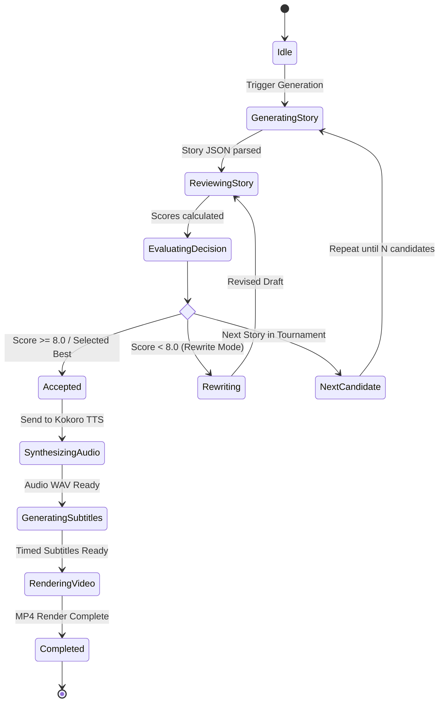

# System Design Specification
## Project: AI-Story-Engine
**An Agentic AI Pipeline for Automated Story Generation, Evaluation, and Short-Form Video Creation**

---

## 1. Design Principles & Goals

1. **Strict Modularity:** Every agent (Generator, Critic, Rewriter, TTS, Video) is decoupled and independently testable through clean JSON contracts.
2. **Defensive Parsing & Fault Tolerance:** Local LLMs may occasionally produce markdown fences or irregular tokens; all parsing pipelines incorporate automated cleaning and fallback recovery.
3. **Hardware Efficiency:** Optimized for consumer NVIDIA GPUs (e.g. 6GB–12GB VRAM), coordinating memory sharing between Ollama LLM inference and Kokoro PyTorch audio synthesis.
4. **Deterministic Reproducibility:** Every story package, critic report, audio file, and video is persistently stored with sequential IDs (`story_0001.json`, `story_0001.wav`, `story_0001.mp4`).

---

## 2. Module Design & Class Structures

### 2.1 Configuration Manager (`app/config.py`)
Centralizes all runtime hyperparameters, paths, model selectors, and defaults:
- `OLLAMA_URL`: Default `http://localhost:11434/api/generate`
- `OLLAMA_TAGS_URL`: Default `http://localhost:11434/api/tags`
- `MODEL`: Configured model name (`qwen3:8b`, `qwen2.5:7b`, etc.) with dynamic fallback discovery
- `VOICE`: Voice identifier (`af_heart`, `af_bella`, `am_adam`, `bm_fable`)
- `ACCEPT_THRESHOLD`: Minimum overall score required to pass without rewriting (default: `8.0`)
- `NUM_CANDIDATES`: Number of candidates in Tournament Ranking mode (default: `3` to `5`)
- `VIDEO_WIDTH`, `VIDEO_HEIGHT`, `FPS`: `1080`, `1920`, `30`
- `AUDIO_SAMPLE_RATE`: `24000` (Kokoro native output)

### 2.2 Story Generator Agent (`app/llm.py`)
- **Input:** Prompt loaded from `prompts/story_prompt.txt`.
- **Processing:** Sends a streaming JSON-formatted request to Ollama so model
  loading and token generation do not hit a short first-byte timeout.
- **Output Validation:** Validates presence of `title`, `hook`, `story`, `thumbnail_prompt`, and `scene_prompts`.
- **Persistence:** Assigns sequential index `data/stories/story_{next_id:04d}.json`.

### 2.3 AI Critic Quality Analyzer (`app/critic.py`)
- **Input:** Story package JSON + `prompts/critic_prompt.txt`.
- **Validation:**
  - Enforces the **Logical Consistency Rule**: Verifies alignment between premise, hook, body, and twist.
  - Scores must contain all 9 dimensions (`hook`, `pacing`, `emotion`, `believability`, `twist`, `retention`, `originality`, `ai_naturalness`, `comment_potential`) and `overall`.
  - Checks for `weaknesses`, `improvements`, `ai_flags`, `retention_drops`, and `decision` (`ACCEPT`, `REWRITE`, `REJECT`).

### 2.4 Story Rewriter / Editor Agent (`app/editor.py`)
- **Input:** Original story package JSON + Critic review JSON + `prompts/editor_prompt.txt`.
- **Contract:** Adheres strictly to the **Preservation Rule**—only edits sentences directly flagged by the Critic.
- **Output:** Returns refined story package retaining the exact JSON structure.

### 2.5 Tournament Ranker Agent (`app/ranker.py`)
- **Purpose:** Solves the challenge noted in `app/notes.md`: candidate ranking often achieves higher viral potential than iterative rewriting alone.
- **Algorithm:**
  1. Generate $K$ candidates ($K \in [3, 5]$).
  2. Critique all $K$ candidates via Critic Agent.
  3. Calculate composite retention ranking score:
     $$S = 0.40 \cdot \text{overall} + 0.20 \cdot \text{retention} + 0.20 \cdot \text{hook} + 0.10 \cdot \text{originality} + 0.10 \cdot \text{believability}$$
  4. Select candidate with $\max(S)$. If tied, select higher `confidence` and `ai_naturalness`.

### 2.6 Kokoro TTS Voice Synthesizer (`app/tts.py`)
- **VRAM Strategy:** Automatically detects CUDA availability. If VRAM is constrained, operates on CPU without significant latency degradation due to Kokoro's lightweight 82M architecture.
- **Synthesis:** Chunks story sentences into phoneme batches, streams through `KPipeline`, concatenates audio tensors, and writes to 24kHz standard WAV format using `soundfile`.

### 2.7 Subtitle & Timestamp Engine (`app/subtitles.py`)
- **Algorithm:**
  - Computes sentence-level and phrase-level pacing based on total audio duration $T_{total}$ and word counts.
  - Generates timed subtitle events with start/end millisecond timestamps.
  - Enforces line-length constraints ($< 4$ words per chunk for rapid viral Shorts reading).

### 2.8 Video Compositor Agent (`app/video.py`)
- **Engine:** MoviePy / FFmpeg.
- **Assembly Pipeline:**
  1. Loads background video clip (from `assets/backgrounds/`).
  2. Resizes and center-crops video to 9:16 vertical aspect ratio (1080x1920).
  3. Loops or trims video clip to match narration duration $T$.
  4. Generates animated text overlays using PIL / MoviePy TextClip with heavy outline and drop shadow.
  5. Combines narration voice audio (100% volume) and ducked background music (15% volume).
  6. Renders final short to `data/videos/story_{id:04d}.mp4`.

---

## 3. Data Flow & State Machine

---

## 4. Error Handling & Recovery Strategies

| Failure Mode | Trigger | Recovery Action |
| :--- | :--- | :--- |
| **Ollama Offline** | Connection refused at `11434` | Return clear error message with launch instructions (`ollama serve`). |
| **Model Not Found** | Specified Qwen tag not pulled | Query `/api/tags` and fall back to first installed Qwen model or notify user. |
| **Malformed JSON** | LLM returned conversational pre-amble | Strip markdown code fences, parse with regex JSON extractor, or retry once. |
| **TTS Audio Clip** | Audio exceeds buffer or GPU memory | Fallback to CPU pipeline execution and sentence-by-sentence streaming. |
| **Missing Assets** | No background video in `assets/backgrounds` | Generate dynamic procedural gradient/solid background canvas. |
