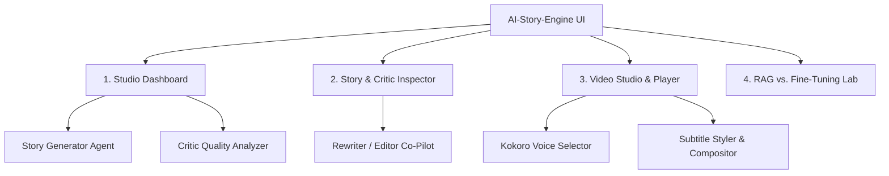

# User Interface & User Experience (UI/UX) Specification
## Project: AI-Story-Engine
**An Agentic AI Pipeline for Automated Story Generation, Evaluation, and Short-Form Video Creation**

---

## 1. UI/UX Vision & Philosophy
The **AI-Story-Engine** interface bridges the gap between deep agentic AI pipelines and seamless, frictionless creator workflows. Creators should be able to produce viral shorts either through a **One-Click Automated Flow** or an **Agentic Co-Pilot Studio** where they can inspect, tweak, and orchestrate each agent's decisions.

---

## 2. Information Architecture & Layout

The UI is architected around 4 primary views:
1. **Studio Dashboard (Live Pipeline):** One-click generation, step-by-step agentic status, live progress, and batch queue.
2. **Story & Critic Inspector:** Deep-dive into generated narratives, radar visualization of the 9 critic dimensions, and AI artifact flags.
3. **Video Studio & Player:** 9:16 vertical video preview, subtitle styling controls, background selection, and audio mixer.
4. **Extension Benchmark Lab:** Side-by-side comparison of Baseline vs. RAG vs. Fine-Tuned stories.



---

## 3. Screen Specifications & Wireframes

### 3.1 Studio Dashboard (Pipeline View)

```
+----------------------------------------------------------------------------------------------------+
|  AI-STORY-ENGINE   [Model: Qwen3 8B (Ollama)]   [Voice: af_heart]   [Mode: Tournament / Best-of-5] |
+----------------------------------------------------------------------------------------------------+
| [ > Generate Story Short ]  [ + Batch Generate (10) ]   [ Settings ]                               |
+----------------------------------------------------------------------------------------------------+
| PIPELINE STATUS                                                                                    |
| [✓] 1. Story Prompt Generated                                                                      |
| [✓] 2. Ollama Qwen Generation (5 Candidates Generated)                                             |
| [✓] 3. AI Critic Evaluated (Scores: 7.4, 8.6, 6.9, 8.2, 7.8)                                       |
| [▶] 4. Kokoro Voice Synthesis (Synthesizing Candidate #2 @ 24kHz...)                               |
| [ ] 5. Video Composition (Awaiting Audio Render)                                                   |
+----------------------------------------------------------------------------------------------------+
| RECENT STORIES & SHORTS                                                                            |
| -------------------------------------------------------------------------------------------------- |
| ID      | Title                      | Score | Duration | Audio     | Video        | Action       |
| #0001   | The Package on the Porch   | 8.6   | 54s      | [▶ Play]  | [▶ Preview]  | [Open / Edit]|
| #0002   | The Key in the Floorboard  | 8.2   | 58s      | [▶ Play]  | [▶ Preview]  | [Open / Edit]|
+----------------------------------------------------------------------------------------------------+
```

### 3.2 Story & Critic Inspector (Quality Analyzer)

Creators can examine the breakdown of the 9 critical retention dimensions:

```
+----------------------------------------------------------------------------------------------------+
| STORY #0001: "The Package on the Porch"                      | CRITIC EVALUATION (Score: 8.6 / 10) |
+--------------------------------------------------------------+------------------------------------+
| Hook (0-5s):                                                 | Hook Strength:      [█████████░] 9 |
| "A random package on my porch changed my entire life."       | Pacing:             [████████░░] 8 |
|                                                              | Emotional Impact:   [████████░░] 8 |
| Story Body:                                                  | Believability:      [█████████░] 9 |
| It was 2 AM when the courier knocked once and vanished...    | Twist Execution:    [████████░░] 8 |
| ...                                                          | Retention Rate:     [█████████░] 9 |
|                                                              | Originality:        [████████░░] 8 |
| Word Count: 332 words | Est. Read Time: 58 seconds           | AI Naturalness:     [█████████░] 9 |
|                                                              | Comment Potential:  [████████░░] 8 |
+--------------------------------------------------------------+------------------------------------+
| WEAKNESSES & RETENTION DROPS                                 | CRITIC DECISION: ACCEPT (92% Conf) |
| - Retention drop at 0:38: Minor pacing drag in paragraph 3.  | [ ✓ Approve for Video ]            |
| - Scene Prompts: 4 consistent visual moments ready.          | [ ↺ Request Agent Rewrite ]        |
+----------------------------------------------------------------------------------------------------+
```

### 3.3 Video Studio & Vertical Preview (9:16)

```
+-----------------------------------------+----------------------------------------------------------+
|          VERTICAL SHORT PREVIEW         | VIDEO & AUDIO CONTROLS                                   |
|               (1080 x 1920)             |                                                          |
|       +-------------------------+       | Background Footage:                                      |
|       |                         |       | [ Minecraft Parkour / Nature Drone / Dark City ▾ ]       |
|       |  [ Atmospheric Video ]  |       |                                                          |
|       |                         |       | Subtitle Styling:                                        |
|       |                         |       | Font: [ Montserrat Black ▾ ]   Size: [ 52px ▾ ]          |
|       |                         |       | Text Color: [ #FFFF00 (Yellow) ▾ ]                       |
|       |   "A RANDOM PACKAGE"    |       | Stroke: [ 4px Black ▾ ]  Highlight: Word-by-word         |
|       |   "ON MY PORCH..."      |       |                                                          |
|       |                         |       | Audio Mixer:                                             |
|       |                         |       | Voice: [ af_heart (Grade A Warm) ▾ ]  Volume: [ 100% ]   |
|       |                         |       | Music: [ Tension Ambient #3 ▾ ]        Volume: [ 15% ]   |
|       +-------------------------+       | Ducking: [ -18dB while speech active ]                   |
|                                         |                                                          |
|       [ ▶ Play ]  [ 00:23 / 00:54 ]     | [ Export MP4 (1080x1920) ]   [ Copy YouTube Metadata ]   |
+-----------------------------------------+----------------------------------------------------------+
```

---

## 4. Interaction Flows & States

### 4.1 Single-Click Creation Flow
1. User clicks **"Generate Short"**.
2. **Phase 1 (Generating):** Prompt loader sends the structured schema to Ollama.
3. **Phase 2 (Critiquing):** Critic agent evaluates the draft against the 9 viral criteria.
4. **Phase 3 (Optimization):**
   - In *Tournament Mode*: Evaluates $N$ candidates in parallel or sequence, selecting the best candidate.
   - In *Rewrite Mode*: If score $< 8.0$, triggers the Rewriter agent to apply micro-fixes and re-evaluates.
5. **Phase 4 (Audio Synthesis):** Kokoro TTS compiles clean 24kHz audio in $\approx 2.5$ seconds.
6. **Phase 5 (Video Rendering):** MoviePy / FFmpeg builds the 9:16 video with kinetic subtitles and audio ducking.
7. User receives a completed `.mp4` file and structured copy for title, hook, and YouTube description.

---

## 5. Accessibility & Design System
- **Color Palette:** Dark-mode primary (`#0F172A` background, `#1E293B` cards, `#6366F1` indigo accents, `#10B981` success emerald, `#EF4444` critique warning).
- **Typography:** Sans-serif UI (Inter, Roboto), Bold Display for Subtitles (Montserrat Black, Impact, Anton).
- **Responsiveness:** Desktop-first layout optimized for creators working on workstations with local GPU monitoring.

